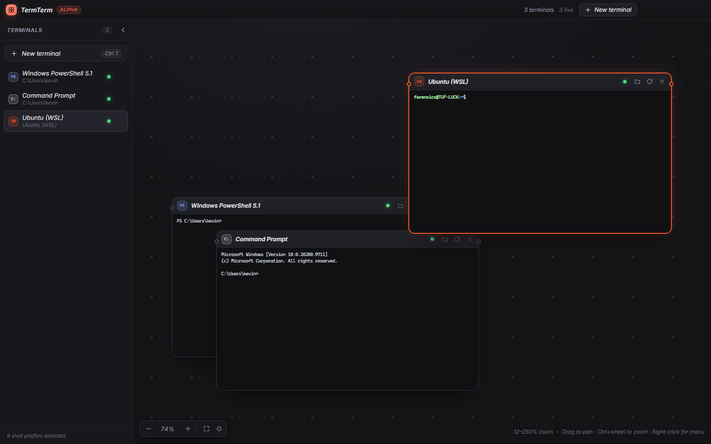

# TermTerm

**A node-based terminal manager for people who live in many shells at once.**



PowerShell, cmd, Git Bash, MSYS2, Cygwin, Nushell, every WSL distro, running Docker/Podman
containers, SSH, Telnet and RDP – each one is a draggable, resizable node on a single infinite
pan-and-zoom canvas instead of a stack of hidden tabs.

## Install

| Platform | Build |
| --- | --- |
| Windows | `TermTerm-<version>-portable.exe` (one file, nothing installed) or `-setup.exe` |
| Linux | `TermTerm-<version>-linux-x86_64.AppImage` |

Download from the Releases page. From source:

```powershell
npm install
npm run dev
```

Press <kbd>F1</kbd> (or **Help** in the title bar) for the in-app help sheet: shortcuts, workflows
and a security summary.

## Documentation

The full manual lives in [docs](docs/index.md):
