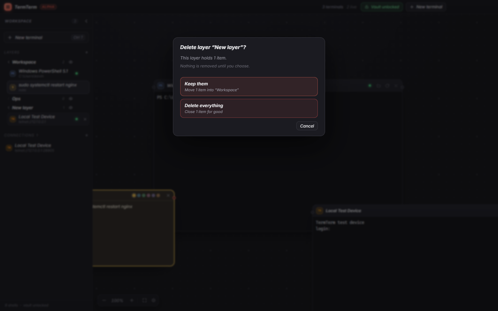
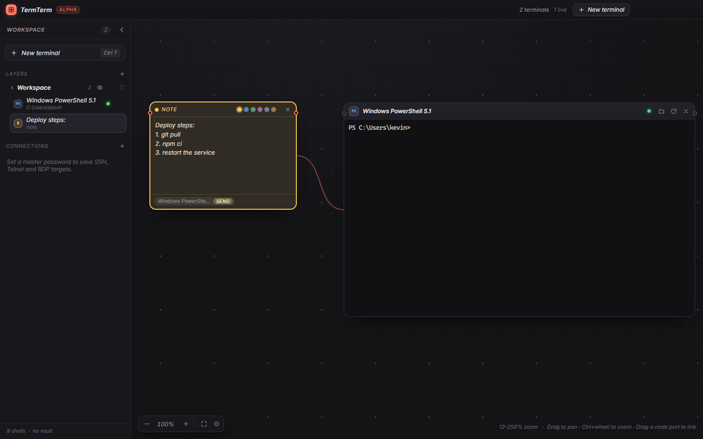

# Canvas, layers and notes

## The canvas

An infinite pan-and-zoom surface with an n8n-style dotted grid. Nodes are real terminals
(`node-pty` + xterm.js), not screenshots: they keep their scrollback, resize correctly, and their
processes keep running while you pan away.

The zoom model is deliberately hybrid: during a gesture the nodes are GPU-scaled, and about 130 ms
after you stop, they are re-laid out at the new scale with a matching font size. Text is sharp at
rest and movement stays smooth.

## Node management

- Drag by the header, resize from any of the 8 handles.
- Rename by double-clicking the title.
- Restart or close from the header, or right-click for the full menu.
- Local shells can be restarted in a chosen folder (header folder button or the context menu).
- Status is visible as a dot in the node header, in the sidebar and in the title bar.
- Search the live buffer and persisted scrollback with <kbd>Ctrl</kbd>+<kbd>F</kbd>; use
  <kbd>Enter</kbd> for the next match and <kbd>Shift</kbd>+<kbd>Enter</kbd> for the previous match.
- Export the terminal scrollback as a plain UTF-8 text file from the header download button or
  terminal context menu.
- Split the selected terminal right for an independent shell in the same node. Use the grid
  button in the node header or the terminal context menu to close it.
- The sidebar navigator flies the camera to any terminal.

## Layers

Layers are folders for terminals: create nested layers, rename by double-click, hide a layer with
the eye icon to clear its terminals off the canvas, and drag a terminal from the sidebar onto a
layer to move it. Hiding is inherited – hiding a parent hides everything inside it.

Deleting a layer that still holds something never guesses for you:

| Choice | What happens |
| --- | --- |
| **Keep them** | Terminals in that layer move to the layer above (or the nearest surviving top-level layer); sublayers are promoted one level with their contents intact |
| **Delete everything** | The layer, every sublayer beneath it, and all their terminals are removed – the sessions are closed |

Empty layers disappear immediately, without a prompt.

## Sticky notes and links

<kbd>Ctrl</kbd>+<kbd>Shift</kbd>+<kbd>N</kbd> (or right-click the canvas → *New note*) drops a
note. Notes are full nodes: drag by the header, resize, pick one of six colours, and rename through
the sidebar by typing their text.

**Links** connect nodes: grab a node's side port and drop it on another node. The connection is
drawn as a curve with a wide invisible hit area; click a curve to select it and press the × at its
midpoint to remove it.

A link from a note to a terminal is actionable – the note shows a chip per linked terminal, and
**send** types the note's text into that session exactly as if you had typed it (no newline, nothing
executed until you press Enter). That makes notes a safe place for commands you reuse.

> **Storage note:** notes, titles and links live in the unencrypted `layout.json` (only *saved
> connections* go in the vault). Do not paste secrets into a sticky note.

## Layout persistence

Node positions, sizes, titles, layers, links, working directories, camera position and recent
scrollback are restored on launch. If the renderer is recreated while Electron is still running, live sessions are
reattached with recent output replay. Live processes still do not survive a complete app restart
([Roadmap](roadmap.md)).
