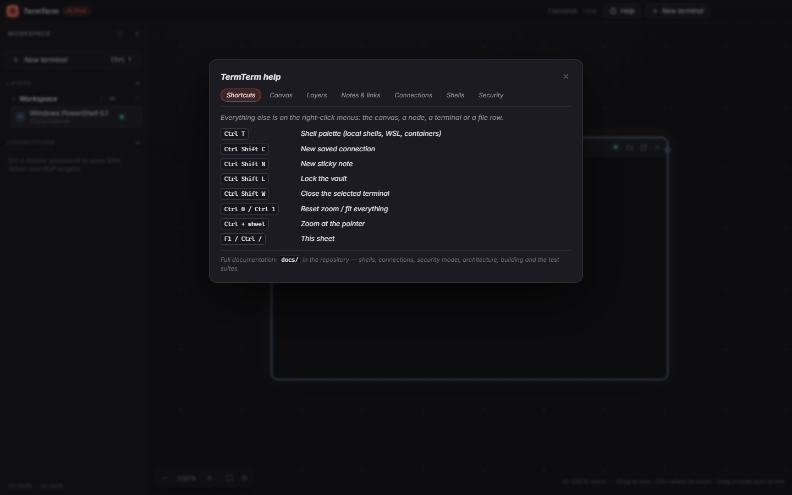

# Getting started

## Install

| You want | Take |
| --- | --- |
| A dev tool that follows you around (USB, OneDrive) | `TermTerm-<version>-portable.exe` – one file, no install, settings live in `TermTerm-data\` next to it |
| Something that looks installed for someone else | `TermTerm-<version>-setup.exe` – per-user NSIS install, no admin rights |
| Linux | `TermTerm-<version>-linux-x86_64.AppImage` (or the `tar.gz`) |

```bash
chmod +x TermTerm-*.AppImage && ./TermTerm-*.AppImage
```

From source:

```powershell
npm install
npm run dev        # Vite + Electron with hot reload
```

The first launch detects your shells and opens one terminal for the platform default. A **master
password** sheet appears: create a vault to store connections (you can skip it and add one later),
or unlock it if you already have one.

## Keyboard shortcuts

Press <kbd>F1</kbd> (or <kbd>Ctrl</kbd>+<kbd>/</kbd>) any time for this list inside the app:



| Input | Action |
| --- | --- |
| <kbd>F1</kbd> / <kbd>Ctrl</kbd>+<kbd>/</kbd> | In-app help |
| Drag empty canvas / middle-drag | Pan |
| <kbd>Ctrl</kbd> + wheel | Zoom at pointer |
| Wheel | Pan the canvas (scrolls the terminal when the pointer is over one) |
| <kbd>Ctrl</kbd>+<kbd>0</kbd> / <kbd>Ctrl</kbd>+<kbd>1</kbd> | Reset zoom to 100 % / fit all terminals |
| <kbd>Ctrl</kbd>+<kbd>T</kbd> | New terminal palette |
| <kbd>Ctrl</kbd>+<kbd>Shift</kbd>+<kbd>N</kbd> | New sticky note |
| <kbd>Ctrl</kbd>+<kbd>Shift</kbd>+<kbd>C</kbd> | New saved connection |
| <kbd>Ctrl</kbd>+<kbd>Shift</kbd>+<kbd>L</kbd> | Lock the vault |
| <kbd>Ctrl</kbd>+<kbd>Shift</kbd>+<kbd>W</kbd> | Close the selected terminal (asks first) |
| Double-click canvas | New terminal at that spot |
| Double-click node title | Rename |
| Drag a node's side port onto another node | Link them |
| Drag a sidebar terminal onto a layer | Move it to that layer |
| Right-click canvas / node | Context menu (new terminal, fit, copy, paste, restart, folder…) |

The <kbd>Ctrl</kbd>+<kbd>T</kbd> launcher searches both detected shells and unlocked saved
connections. Connection results show an explicit connecting state while the session starts.

## Where things live

Settings, layout and the vault sit in the Electron `userData` directory:

| Platform | Path |
| --- | --- |
| Windows (installed) | `%APPDATA%\TermTerm` |
| Windows (portable) | `TermTerm-data\` beside the `.exe` |
| Linux | `~/.config/termterm` |

| File | Contents |
| --- | --- |
| `layout.json` | Nodes, geometry, layers, links, camera – **not** encrypted |
| `vault.json` | Encrypted saved connections (scrypt + AES-256-GCM) |
| `known_hosts` | Host keys you approved for SFTP, in OpenSSH format |
| `profiles.json` | Optional custom shell profiles (see [Shells](shells.md)) |

See [Security](security.md) for what is and is not protected.
