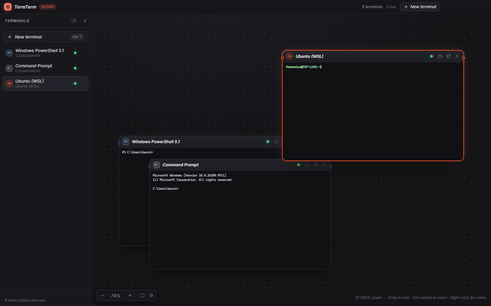

# TermTerm documentation

TermTerm is a node-based terminal manager: every shell you run – PowerShell, cmd, Git Bash, WSL
distros, running containers, SSH, Telnet, RDP – becomes a draggable, resizable node on one
infinite pan-and-zoom canvas.

The application itself carries the parts you need while working: press <kbd>F1</kbd> (or the **?**
in the title bar) for the in-app help sheet with shortcuts and the common workflows. These pages
are the long form.

| Page | What it covers |
| --- | --- |
| [Getting started](getting-started.md) | Install options, first launch, every keyboard shortcut |
| [Shells](shells.md) | What is detected and how, custom `profiles.json`, WSL/Kali, containers |
| [Connections](connections.md) | SSH, Telnet, RDP, X11 forwarding, the SFTP file browser |
| [Canvas, layers and notes](canvas.md) | Zoom model, node management, layer tree, sticky notes and links |
| [Security](security.md) | Vault crypto, host key verification, IPC hardening, what is stored where |
| [Architecture](architecture.md) | Process and file layout, session model, renderer plumbing |
| [Building and releasing](building.md) | Dev scripts, Docker builds, portable vs installer, GitHub releases |
| [Verification](verification.md) | Test suites, the OpenSSH fixture, what each suite proves |
| [Roadmap](roadmap.md) | Known gaps and what is planned next |

## The short version

1. `npm install && npm run dev` (or run a release build).
2. <kbd>Ctrl</kbd>+<kbd>T</kbd> picks a shell; every terminal is a node you can drag, resize and link.
3. <kbd>Ctrl</kbd>+<kbd>Shift</kbd>+<kbd>C</kbd> saves an SSH/Telnet/RDP target behind the master password.
4. <kbd>Ctrl</kbd>+<kbd>Shift</kbd>+<kbd>N</kbd> drops a note; drag a node's port onto another node to link them.
